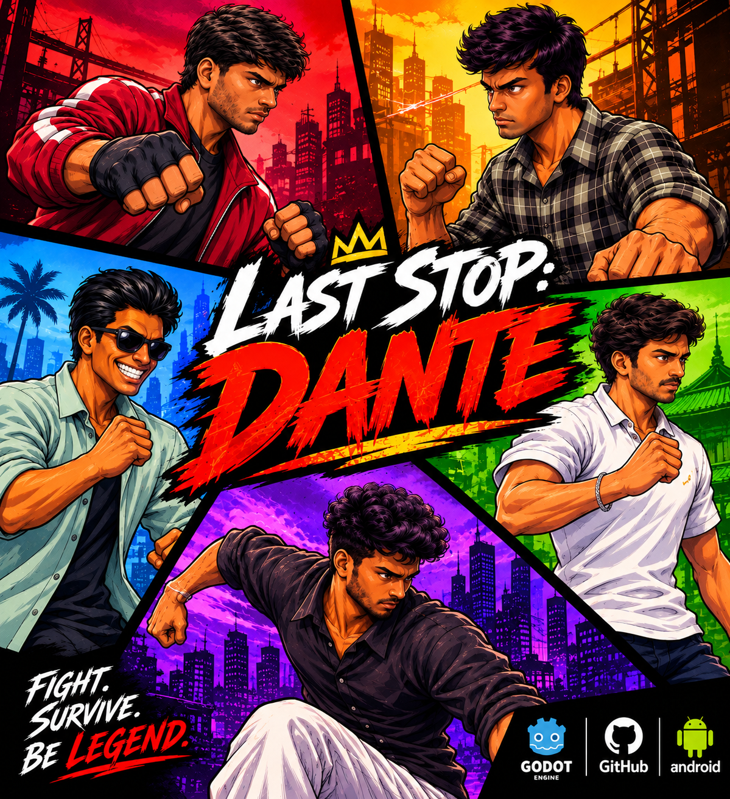
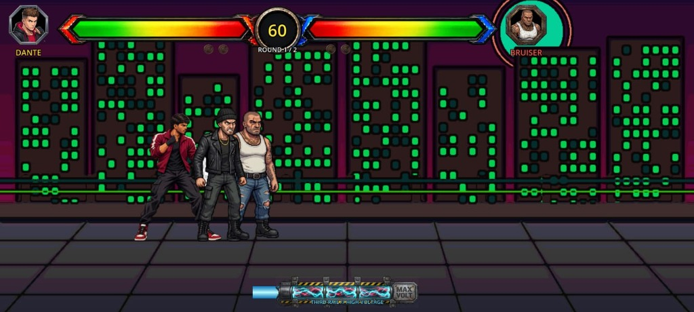
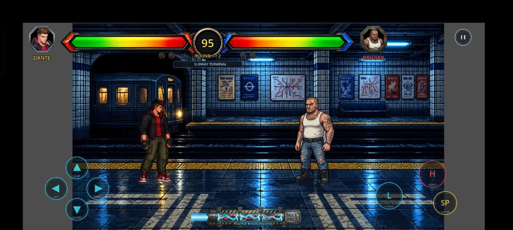
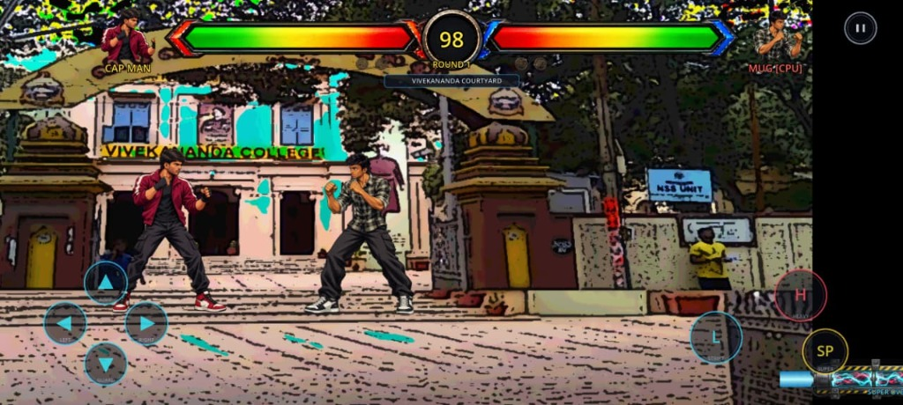

# ⚡ LAST STOP: DANTE

  

  
  
  
  
  

> **"Building beyond the screen — turning imagination into interactive experiences."**

An adrenaline-fueled 2D cyberpunk arcade street-fighting game built with Godot 4. Featuring high-impact martial arts combat, Super Overdrive meters, multi-tier enemy rounds, dynamic hit sparks, cinematic transitions, and a fully customizable drag-and-drop touch control layout for mobile.

---

## 🎮 PLAY & DOWNLOAD

Choose your platform:

* 📱 **[Download Android APK (Direct)](https://github.com/YUVANESH07-08/LastStopDante-Game/releases/latest)** *(159 MB — High-performance native APK, full widescreen support)*
* 💻 **[Download Windows PC Build](https://github.com/YUVANESH07-08/LastStopDante-Game/releases/latest)** *(378 MB — Plug-and-play desktop edition)*
* 🕹️ **[Play & Review on itch.io](https://yuvanesh-r.itch.io/last-stop-dante)** *(Official Indie Game Page)*

### 📱 Android Installation Instructions:
1. Download **`LastStopDante.apk`** directly to your phone.
2. Tap on the downloaded APK to install.
3. If prompted by Android, allow **"Install unknown apps"** for your browser / file manager.
4. Launch **Last Stop: Dante** and jump straight into the fights!

### 💻 Windows PC Instructions:
1. Download **`LastStopDante-Windows.zip`**.
2. Extract the ZIP folder anywhere on your computer.
3. Double-click **`LastStopDante.exe`** to launch immediately. *(No installation required)*

---

## 📸 Screenshots & Showcase

  
  

  

---

## 🥊 Key Game Features

- **Mobile First Touch Controls**: Virtual D-Pad (Jump, Guard, Left, Right) and combat buttons (Light Strike, Heavy Kick, Super Overdrive) with an in-game drag-and-drop HUD customizer.
- **Edge-to-Edge Widescreen Rendering**: Dynamically scales across modern 18:9, 19.5:9, 20:9, and ultra-wide mobile aspect ratios with zero black bars.
- **Dynamic Combat System**: Light/heavy strikes, crouch sweeps, anti-air jumps, directional blocking, and cinematic hit spark VFX.
- **Super Overdrive Voltage Meter**: Build energy with landed attacks and unleash room-clearing Super Strikes when the meter hits MAX VOLT.
- **Fighter Roster**:
  - `Dante` — The Underworld Brawler & Vanguard
  - `Cap Man` — The High-Agility Striker
  - `Mug` — Heavy-Hitting Bruiser
  - `Playboy` — Flashy Tech Specialist
  - `Profes` — Tactical Counter-Attacker
  - `Virat` — Relentless Pressure Fighter
- **Multiple Game Modes**:
  - **Story Mode**: Multi-round subway brawl against gang syndicates and bosses.
  - **Turf Clash**: Battle across campus and urban arenas for territorial dominance.
  - **Local 2-Player Versus (PC)**: Shared-keyboard direct 1v1 combat.

---

## 🕹️ Controls Reference

### 📱 Mobile Touch Controls
- **Virtual D-Pad (Left)**: Directional movement, Jump (Up), and Crouch/Guard (Down).
- **Combat Cluster (Right)**:
  - `L` — Light Strike (Punch combo)
  - `H` — Heavy Strike (High-impact kick)
  - `SP` — Super Overdrive Attack (Activates when meter is charged)
- **Settings & Controls**: Drag and position every button anywhere on your screen with instant position memory.

### 💻 PC Keyboard Controls

| Action | Player 1 (Primary) | Player 2 (Local 1v1) |
|---|---|---|
| **Move Left / Right** | `A` / `D` | `Left Arrow` / `Right Arrow` |
| **Jump** | `W` | `Up Arrow` |
| **Crouch / Guard** | `S` | `Down Arrow` |
| **Light Strike** | `J` | `I` |
| **Heavy Strike** | `K` | `O` |
| **Super / Kick** | `U` | `P` |
| **Pause Menu** | `Escape` | `Escape` |

---

## 👤 Creator & Dossier

* **Creator**: Yuvanesh R
* **Designation**: `DANTE ARCHIVES // CREATOR FILE 001`
* **itch.io**: [@yuvanesh-r](https://yuvanesh-r.itch.io/)
* **GitHub**: [@YUVANESH07-08](https://github.com/YUVANESH07-08)
* **LinkedIn**: [Yuvanesh R](https://www.linkedin.com/in/yuvanesh-r-6915b7380/)

---

  <i>Developed with Godot Engine 4. Dedicated to classic arcade fighters.</i>

